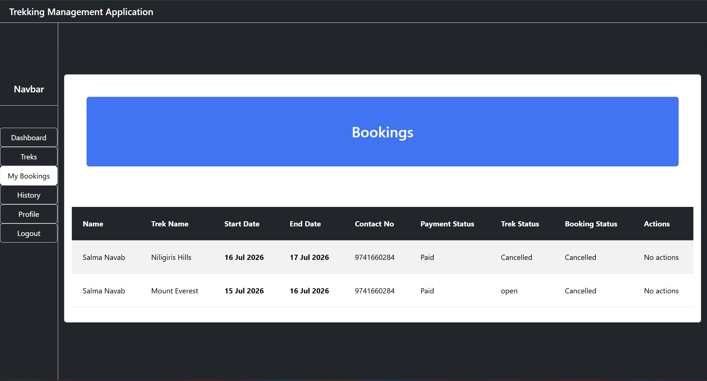
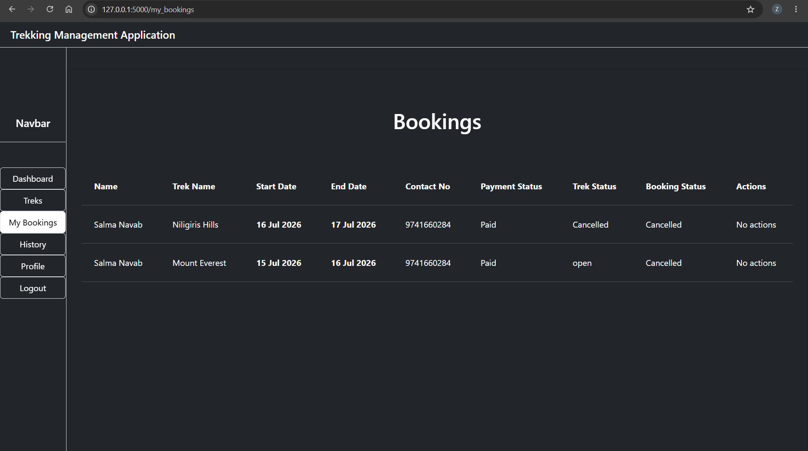

### Trekking Management Application

- Developed a web application for managing trekking activities as part of the IIT Madras BS Degree MAD1 project.
- Demonstrated practical skills in database management, backend development, and web application design.
- Secured an A grade for the project.


### Running the Application

1. Clone or download this repository.
2. Open a terminal or Command Prompt and navigate to the project's root directory (the folder containing `app.py`).
3. Install the required dependencies by running:

   ```bash
   pip install -r requirements.txt
   ```
4. Start the application:

   ```bash
   python app.py
   ```
5. Once the server starts, open the URL displayed in the terminal (usually `http://127.0.0.1:5000`) in your web browser.

#### Default Admin Credentials

The application comes with a pre-configured administrator account:

* **Username:** `akzayan8`
* **Password:** `akzayan8`

- You could change the password and username, by changing the file `create_admin.py`, mainly the part username and password.(Warning: You have to `delete the instance folder` if you ran the program once, for the changed credentials to work, you would also lose the data you inserted before.)

#### Problems I faced

- I had a very difficult time in understanding decorators and wrapper functions, to restrict activity based on roles. So I had to study about decorators and wrappers, then write a function for decorators or to restrict access.

- Even after writing the decorator and applying it before the route to user_dashboard, even without logging in, it was redirecting to the user dashboard, I looked it up then I understood that the browser saves the cookies still the next time, so even tho I ended the server and restarted it, it was still redirecting, so I had to create a logout function which clears the sessions.

- Faced a issue in my profile page, which is common for all admin, staff and user. I used a form for the staff's which was not required for admin and user, it gave me error while going to admin or user profile because I was passing undefined variables in the render_template statement, so I had to define empty strings for all those variables even though it was not being used.

- Overall I had faced a lot of issues in configuaring pages which were shared by both admin and staff, it gave me a lot of errors.

#### Improvements

##### First UI



- Initial UI in which I used cards for everything, finally removed the cards and it looked better.

##### Final UI


